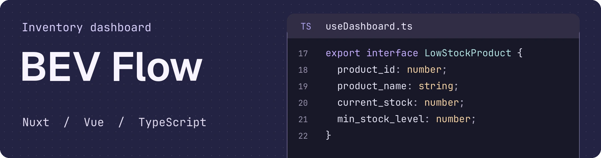
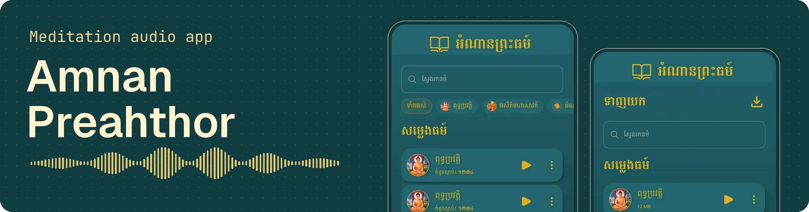

<a href="https://linhcheu.me">
  <picture>
    <source media="(max-width: 600px) and (prefers-color-scheme: light)" srcset="./assets/profile-mobile-light.svg">
    <source media="(max-width: 600px)" srcset="./assets/profile-mobile.svg">
    <source media="(prefers-color-scheme: light)" srcset="./assets/profile-light.svg">
    
  </picture>
</a>

# Linhcheu Meng

I’m a UX/UI designer and frontend developer in Phnom Penh. I work in Khmer and English. Some days I’m in Figma figuring out how a student saves a scholarship. Other days I’m in a terminal wiring up a stock alert.

[](https://linhcheu.me)
[](https://linhcheu.me/gallery)
[](https://www.behance.net/linhcheumeng)
[](https://linkedin.com/in/cheu0426)

## Selected builds

[](https://github.com/linhcheu/bev-flow)

A low-stock alert is only useful if you know who to call. I built **BEV Flow**, a dashboard that puts stock levels, supplier records, and sales reports in one place. Built with **Nuxt, Vue, and TypeScript**. [Browse the repository →](https://github.com/linhcheu/bev-flow)

[](https://linhcheu.me/uxui/orkas)

A student finds a scholarship on Telegram. What happens between saving the link and submitting the application? **Orkas** is my 26-screen Figma prototype for that process. Students can save opportunities, check what each application needs, and track deadlines in Khmer or English. [Read the case study →](https://linhcheu.me/uxui/orkas)

[](https://apps.apple.com/kh/app/amnan-preahthor/id6767218899)

I designed the mobile listening experience for **Amnan Preahthor**, a meditation app. One detail I worked on was how listeners loop a passage when they want to hear it again. [iOS ↗](https://apps.apple.com/kh/app/amnan-preahthor/id6767218899) · [Android ↗](https://play.google.com/store/apps/details?id=com.preahthor.app)

<details>
<summary><strong>Inside my dev setup</strong></summary>

```ts
const workbench = {
  os: "Linux",
  design: "Figma",
  frontend: ["TypeScript", "Next.js", "Nuxt", "Tailwind CSS"],
  terminal: ["Claude Code", "OpenAI Codex"],
};
```

I turn recurring tasks into reusable agent skills. The design work has its own archive, from Khmer event posters to the MIS Challenge campaign. [Open the gallery →](https://linhcheu.me/gallery)

</details>
