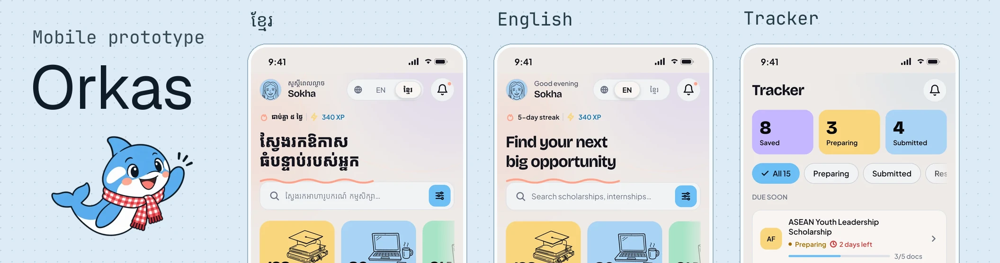

# Hi, I’m Linhcheu Meng.

I’m a UX/UI designer and frontend developer in Phnom Penh, Cambodia. I work in Khmer and English, and I like taking an interface from the first sketch in Figma to the details people touch every day.

[Portfolio](https://linhcheu.me) · [Graphic design gallery](https://linhcheu.me/gallery) · [Behance](https://www.behance.net/linhcheumeng) · [LinkedIn](https://linkedin.com/in/cheu0426)

## Selected work

**Orkas** · UX research and product design

I designed a Khmer and English prototype for Cambodian students who find scholarships and internships through Telegram. Across 26 screens, students can save an opportunity, see what an application needs, and keep track of its deadline. [Explore the case study →](https://linhcheu.me/uxui/orkas)

**Amnan Preahthor** · Mobile UX/UI

I designed the listening experience for this mindfulness and meditation app, including the loop and repeat controls for people who return to the same passage. [App Store](https://apps.apple.com/kh/app/amnan-preahthor/id6767218899) · [Google Play](https://play.google.com/store/apps/details?id=com.preahthor.app)

**BEV Flow** · Full-stack development

I built a Nuxt and TypeScript inventory dashboard that connects stock levels, suppliers, and sales. Low-stock alerts help people decide what to reorder. [View the code →](https://github.com/linhcheu/bev-flow)
